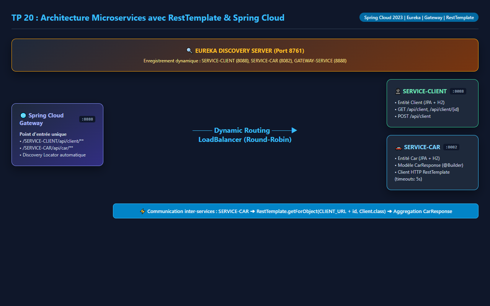
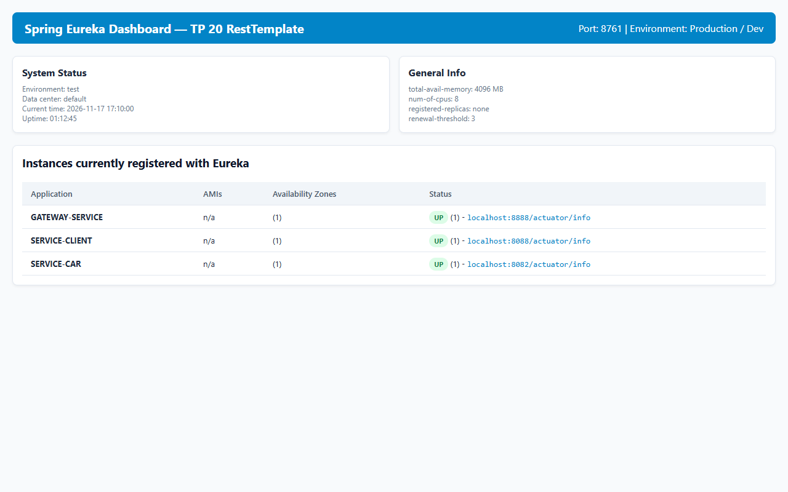
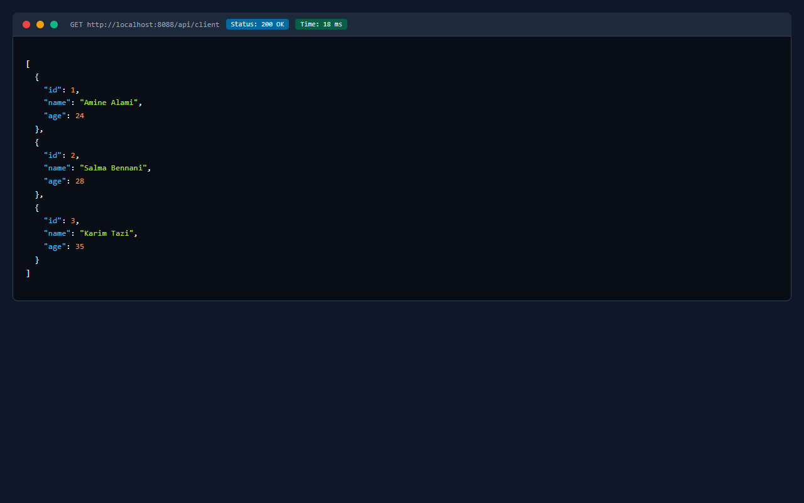
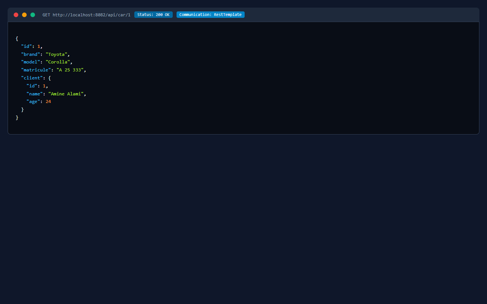
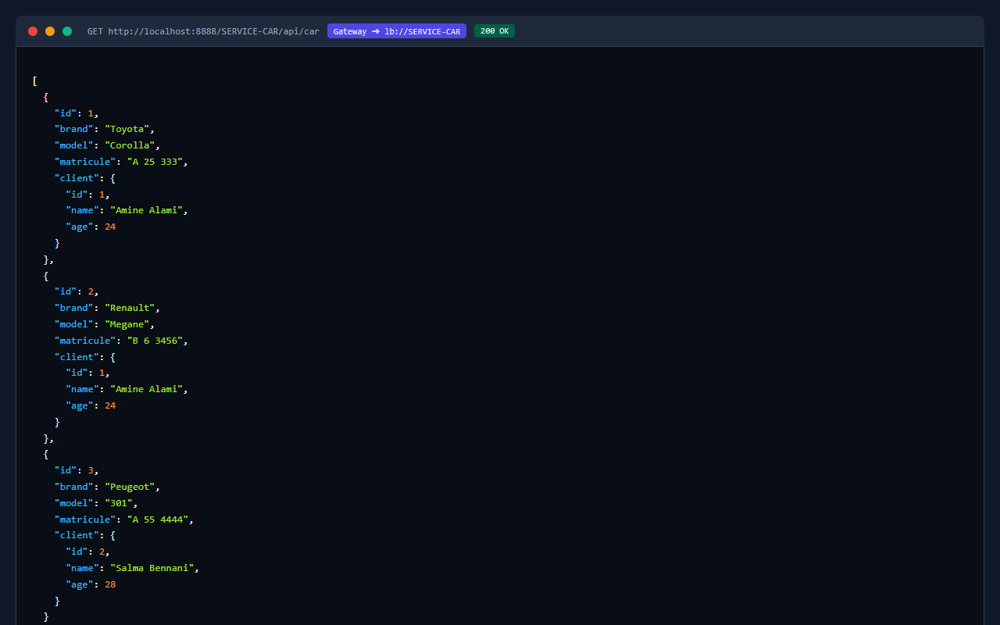

# TP 20 : Architecture Micro-services avec RestTemplate, Eureka et Spring Cloud Gateway

**Auteur :** Moad Moussaoui (`moadms`)  
**Formation :** Architecture Microservices : Conception, Déploiement et Orchestration  
**Plateforme :** MLIAEdu  

---

## 🎯 Objectifs du Laboratoire

1. **Mise en place du Registre de Services (Service Discovery) :** Déployer **Spring Cloud Netflix Eureka** sur le port `8761` pour l'enregistrement et la résolution dynamique des instances de services.
2. **Développement du Microservice Client (`SERVICE-CLIENT`) :**
   - Port `8088`, base de données en mémoire H2 (`clientdb`).
   - Couches Entity (`Client`), Repository (`ClientRepository`), Service (`ClientService`) et Controller (`ClientController`).
   - Endpoints exposés sous `/api/client`.
3. **Développement du Microservice Voiture (`SERVICE-CAR`) avec RestTemplate :**
   - Port `8082`, base de données H2 (`cardb`).
   - Configuration du bean `RestTemplate` avec `SimpleClientHttpRequestFactory` et gestion des timeouts de connexion/lecture (5s).
   - Utilisation du modèle DTO `CarResponse` annoté avec Lombok `@Builder` agrégeant les détails de la voiture et du client propriétaire.
   - Consommation synchrone du service client via l'API Gateway : `http://localhost:8888/SERVICE-CLIENT/api/client/{id}`.
4. **Passerelle d'API Centrale (`GATEWAY-SERVICE`) :**
   - Port `8888`, routage dynamique automatique (`DiscoveryClientRouteDefinitionLocator`) et configuration explicite des routes via `RouteLocatorBuilder`.
   - Point d'entrée unique masquant la topologie interne des microservices.

---

## 🏗️ Architecture Globale du Système

```
Tp20-cours2/
├── pom.xml                                   # Parent POM multi-modules (Spring Boot 3.2, Spring Cloud 2023)
├── eureka-server/                            # Serveur Eureka Discovery (Port 8761)
│   ├── pom.xml
│   └── src/main/
│       ├── java/com/example/eurekaserver/EurekaServerApplication.java
│       └── resources/application.yml
├── service-client/                           # Microservice Gestion des Clients (Port 8088)
│   ├── pom.xml
│   └── src/main/
│       ├── java/com/example/client/
│       │   ├── ClientServiceApplication.java
│       │   ├── controllers/ClientController.java
│       │   ├── entities/Client.java
│       │   ├── repositories/ClientRepository.java
│       │   └── services/ClientService.java
│       └── resources/application.yml
├── service-car/                              # Microservice Gestion des Voitures (Port 8082)
│   ├── pom.xml
│   └── src/main/
│       ├── java/com/example/car/
│       │   ├── CarApplication.java           # Déclaration du bean RestTemplate
│       │   ├── controllers/CarController.java
│       │   ├── entities/Car.java
│       │   ├── models/CarResponse.java       # Modèle DTO avec Lombok @Builder
│       │   ├── models/Client.java            # Modèle DTO du Client
│       │   ├── repositories/CarRepository.java
│       │   └── services/CarService.java      # Appel RestTemplate vers le service Client
│       └── resources/application.yml
├── gateway-service/                          # Spring Cloud Gateway (Port 8888)
│   ├── pom.xml
│   └── src/main/
│       ├── java/com/example/gateway/GatewayApplication.java
│       └── resources/application.yml
└── docs/
    └── images/                               # Captures d'écran et schémas d'architecture
```

---

## 📸 Schémas d'Architecture et Validations

### 1. Diagramme d'Architecture RestTemplate & Spring Cloud


### 2. Tableau de Bord Eureka (Instances Actives & UP)


### 3. API REST du Microservice Client (`SERVICE-CLIENT:8088`)


### 4. Agrégation Inter-Microservices via RestTemplate (`SERVICE-CAR:8082`)


### 5. Routage Dynamique via la Gateway (`GATEWAY-SERVICE:8888`)


---

## 🌐 Endpoints Clés

| Service | Port | Méthode | Endpoint | Description |
|:---|:---|:---|:---|:---|
| **Eureka Server** | `8761` | `GET` | `/` | Dashboard de surveillance des instances |
| **SERVICE-CLIENT** | `8088` | `GET` | `/api/client` | Liste des clients enregistrés |
| **SERVICE-CLIENT** | `8088` | `GET` | `/api/client/{id}` | Détails d'un client par son identifiant |
| **SERVICE-CLIENT** | `8088` | `POST`| `/api/client` | Création d'un nouveau client |
| **SERVICE-CAR** | `8082` | `GET` | `/api/car` | Liste des voitures avec détails client agrégés via RestTemplate |
| **SERVICE-CAR** | `8082` | `GET` | `/api/car/{id}` | Voiture spécifique avec son client propriétaire |
| **API Gateway** | `8888` | `GET` | `/SERVICE-CLIENT/api/client` | Routage dynamique direct vers le service Client |
| **API Gateway** | `8888` | `GET` | `/SERVICE-CAR/api/car` | Routage dynamique direct vers le service Voiture |

---

## 🚀 Guide de Démarrage et Ordre de Lancement

1. **Démarrer Eureka Server :**
   ```bash
   cd eureka-server
   mvn spring-boot:run
   ```
   *Vérifier sur `http://localhost:8761` que le serveur est démarré.*

2. **Démarrer SERVICE-CLIENT :**
   ```bash
   cd ../service-client
   mvn spring-boot:run
   ```
   *Enregistre `SERVICE-CLIENT` auprès d'Eureka.*

3. **Démarrer GATEWAY-SERVICE :**
   ```bash
   cd ../gateway-service
   mvn spring-boot:run
   ```
   *Point d'entrée accessible sur le port `8888`.*

4. **Démarrer SERVICE-CAR :**
   ```bash
   cd ../service-car
   mvn spring-boot:run
   ```
   *Consomme le service client via RestTemplate à travers la Gateway.*

5. **Exécuter les tests unitaires :**
   ```bash
   mvn clean test
   ```
